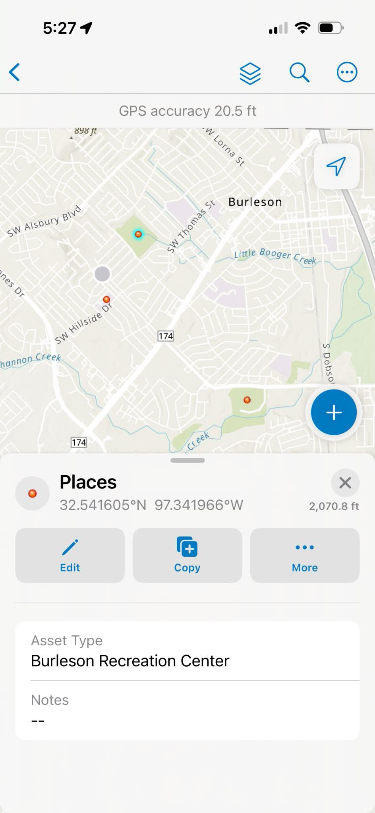

# Lab 02 – ArcGIS Online Web Mapping and Data Collection

**Student:** Kelly Williams

## Part 1: My First Web Application

I created an interactive web mapping application using ArcGIS Online to display adult obesity rates by county in Texas for 2017. I customized the map's colors, pop-ups, and filters before publishing the application.

**Application Name:** My first Web App - Kelly Williams

**Published Web Application:** [Click here to view my web application](https://tamu.maps.arcgis.com/apps/instant/basic/index.html?appid=55665076d4ae4c5cba17ce53c398150c)

## Part 2: Mobile Data Collection

I created a web map called **Parks Data Collection - Kelly Williams** using ArcGIS Online. I configured feature layers for places, paths, and areas, then opened the map using ArcGIS Field Maps on my iPhone to collect geographic information.

## Field Maps Screenshot

